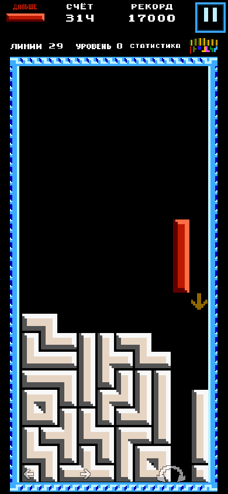
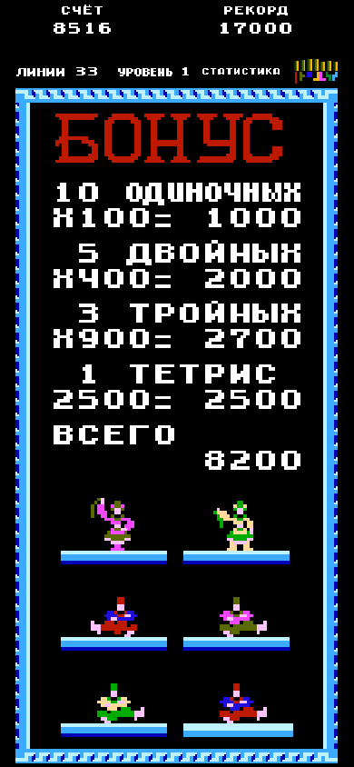

# Tengen Tetris для браузера

**[Играть](https://superoles-red.github.io/tetris-dendy-web/)** · [Галерея](screenshots/README.md)

Оригинальный Tetris с Dendy на русском и английском. Картридж отвечает за фигуры, скорость, музыку и очки. На телефоне колодец разворачивается вместе с экраном, а во время подсчёта бонуса на его месте танцуют до шести персонажей.

Игру можно установить на главный экран и запускать без интернета. При подключении к сети обновление загружается автоматически и вступает в силу в главном меню.

| Партия | Бонусный танец |
| --- | --- |
|  |  |
