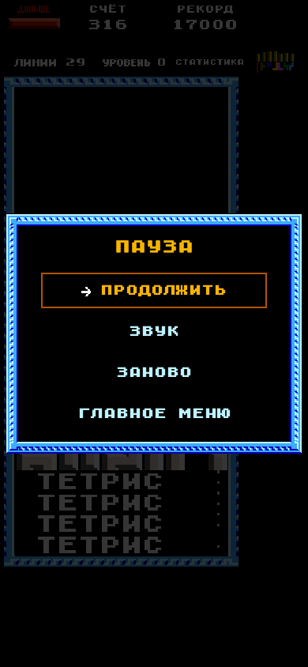
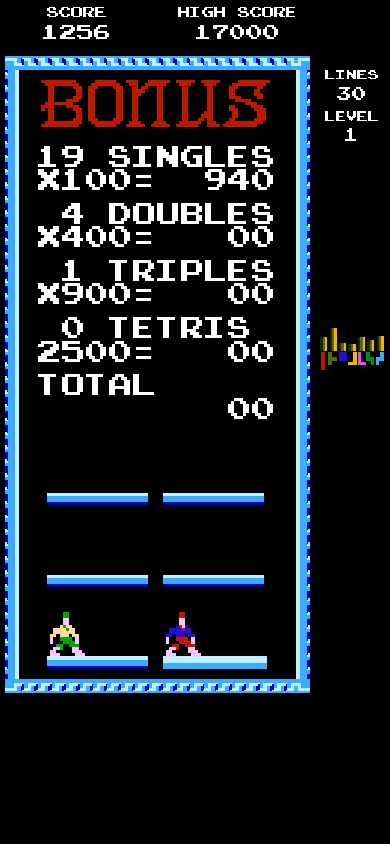
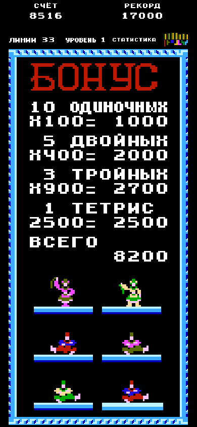
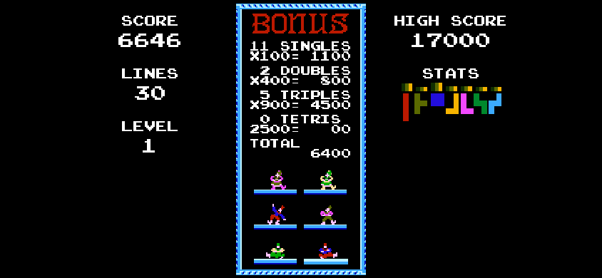
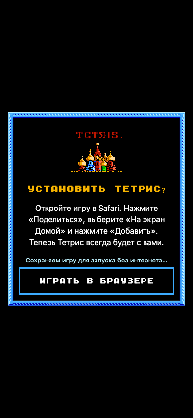
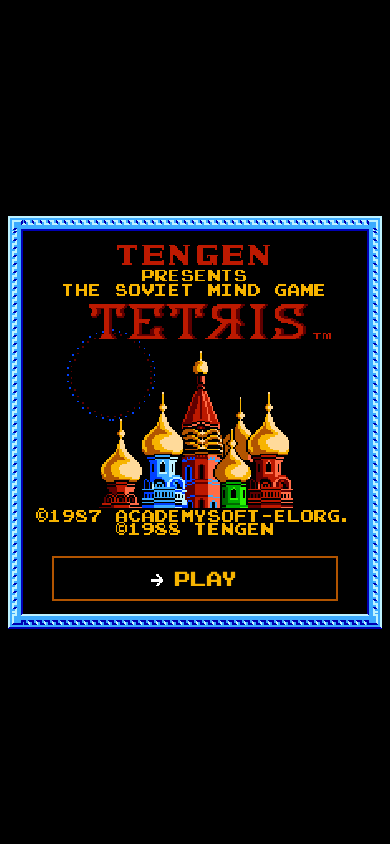
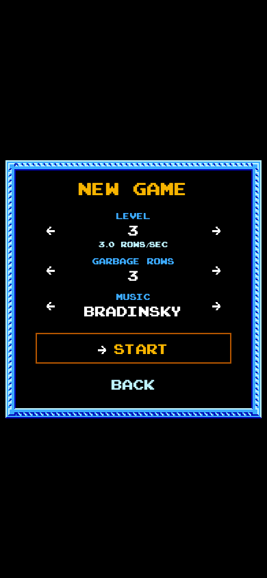
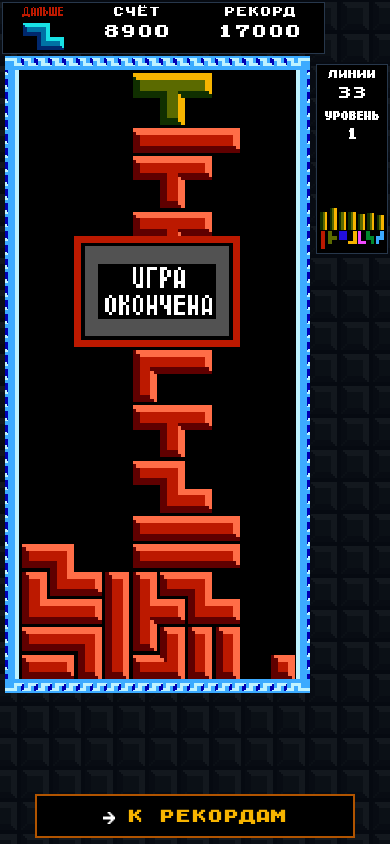
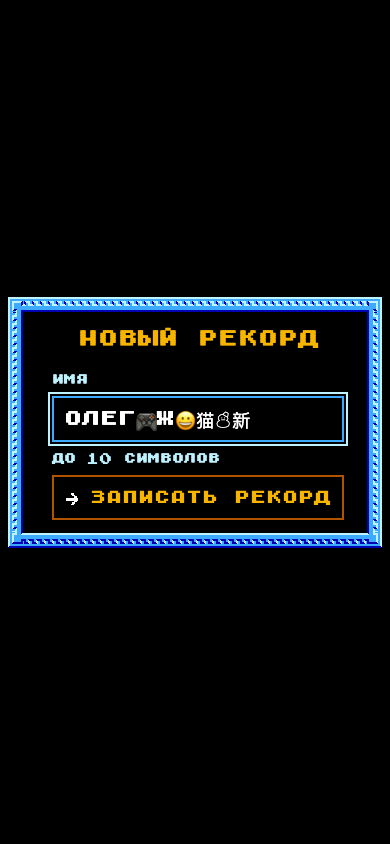
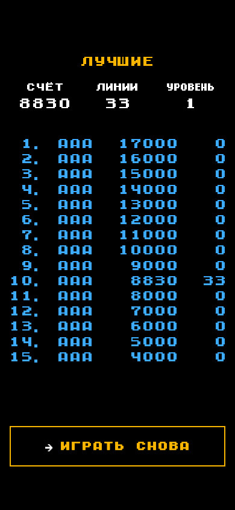

# Галерея Tengen Tetris

[Играть в браузере](https://superoles-red.github.io/tetris-dendy-web/) · [О проекте](../README.md)

## Партия

| Вертикальный экран, русская версия | Пауза |
| --- | --- |
|  |  |

[Портретный экран iPhone с отступом под часы](iphone-portrait.png). Кадр из браузерной эмуляции с профилем 393 × 852 и верхней системной областью 59 пикселей.

**Горизонтальный экран, английская версия.** Колодец расположен по центру, следующая фигура и статистика видны по сторонам.

## Бонусные танцы

Картридж выбирает число танцоров по тому, сколько раз за этап удалось убрать сразу три или четыре линии. На этих кадрах шесть танцоров появились в двух отдельных партиях, сыгранных на русском и английском картриджах.

| Два танцора | Шесть танцоров |
| --- | --- |
|  |  |

## Перед игрой

| Установка | Главное меню | Новая игра |
| --- | --- | --- |
|  |  |  |

[Громкость, мелодия и язык во время паузы](sound.png)

## После партии

| Конец игры | Ввод инициалов | Таблица рекордов |
| --- | --- | --- |
|  |  |  |
