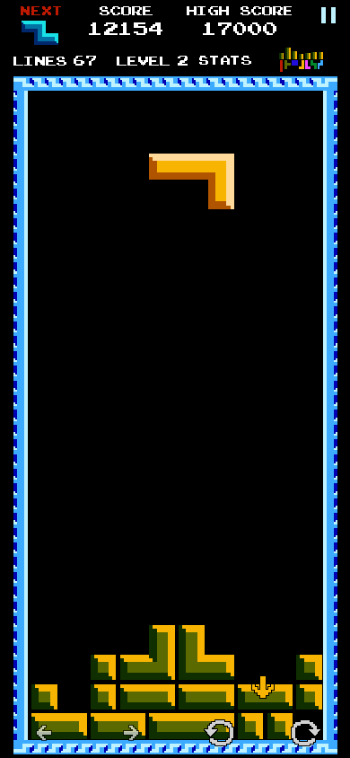
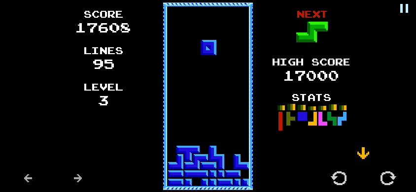
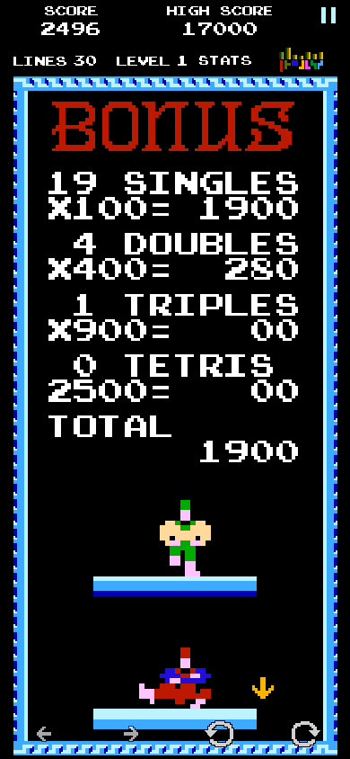
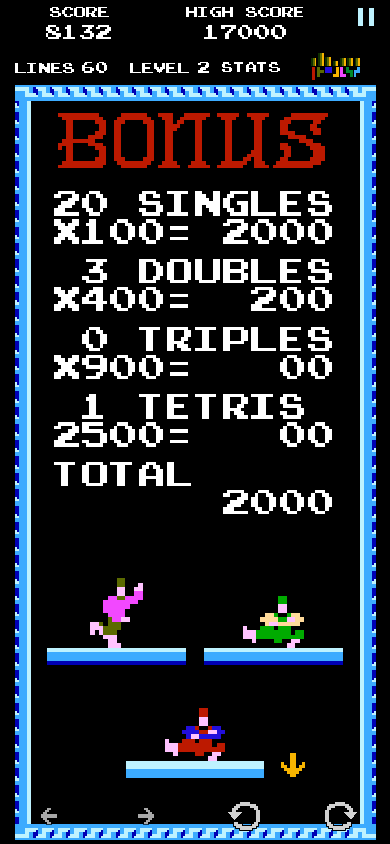
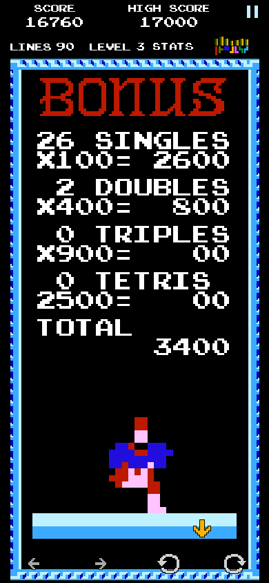

# Кадры игры

[Открыть игру](https://superoles-red.github.io/tetris-dendy-web/)

Эти кадры сняты в браузере с опубликованной версии. Для поздних этапов загружены состояния картриджа из контрольной партии.

### Партия и рекорд

| 67 линий, вертикальный экран | Ввод инициалов после 95 линий |
| --- | --- |
|  |  |

**95 линий, горизонтальный экран**

[Завершение партии](game-over.png)

### Бонусные танцы

| 30 линий | 60 линий | 90 линий |
| --- | --- | --- |
|  |  |  |

### Меню

[Заставка](title.png) · [Уровень, скорость и музыка](setup.png) · [Пауза](pause.png) · [Громкость и выбор трека](sound.png)
